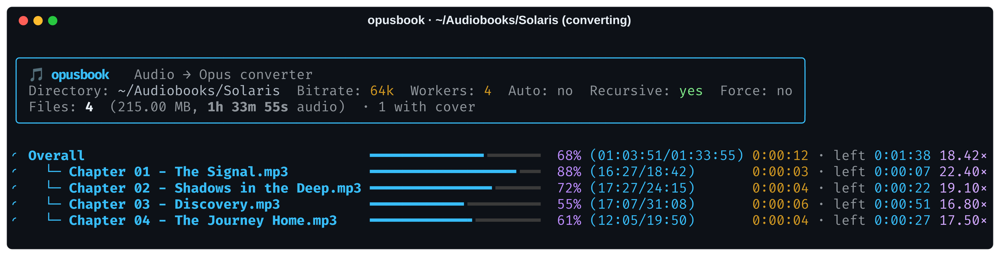
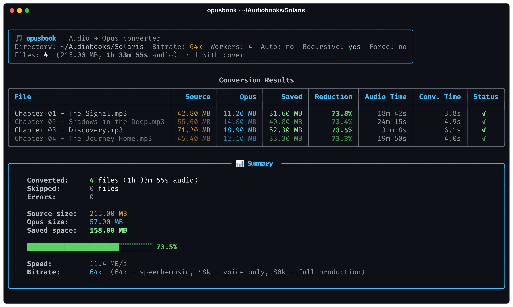
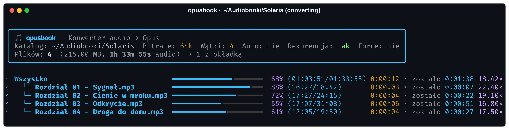
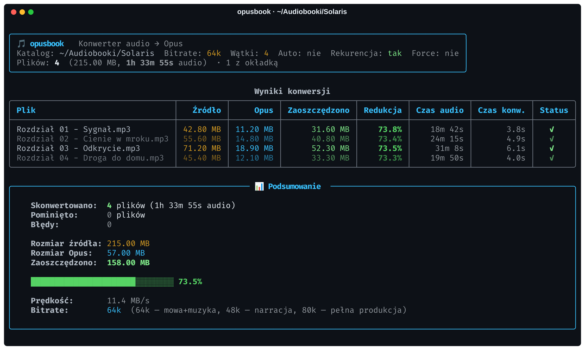

# 🎵 opusbook

> 🎧 **EN:** Convert audiobooks, radio plays, and podcasts to Opus from the terminal.
>
> 🇵🇱 **PL:** Konwertuj audiobooki, słuchowiska i podcasty do Opus z terminala.

[ 🇬🇧 English ](#-english) • [ 🇵🇱 Polski ](#-polski)


[](LICENSE)

---

## 🇬🇧 English

A command-line tool that converts audio files (**MP3, M4B, M4A, FLAC, AAC, WAV, OGG, WMA**) into **`.opus`** so your audiobook library takes up significantly less disk space. Built with a colorful terminal UI (`rich`), interactive bitrate selection, parallel multi-core encoding, and automatic cover art extraction for media servers such as **Audiobookshelf**.





### ✨ Key Features

- 🎧 **Broad format support** — converts `.mp3`, `.m4b`, `.m4a`, `.flac`, `.aac`, `.wav`, `.ogg`, and `.wma` to `.opus` via `ffmpeg` (`libopus`, VBR, `-application audio`).
- 🎯 **Interactive bitrate picker** — choose `48k`, `64k`, or `80k` from an arrow-key terminal menu, or pass `-b 64k` directly on the command line.
- 🧠 **Smart `--auto` mode** — automatically detects channel count (`mono → 32k`, `stereo → target bitrate from -b`).
- 📁 **Recursive directory scanning (`-r`)** — processes entire multi-folder audiobook collections in one run.
- ⚡ **Parallel encoding (`-j N`)** — runs multiple `ffmpeg` workers concurrently with per-file and overall progress bars.
- 🖼️ **Sidecar cover extraction** — extracts embedded cover art to `cover.jpg` alongside the converted files so players like Audiobookshelf pick it up automatically (video streams are stripped from `.opus`, keeping only the primary audio stream `0:a:0`).
- 📊 **Detailed summary table** — displays saved megabytes, size reduction percentage, and wall-clock encoding speed.
- 🛡️ **Safe file handling** — validates every output file before replacing existing `.opus` files (`--force`) or deleting originals (`--delete`). Stops before encoding if two source files in the same folder would produce the same `.opus` filename.
- 🤖 **Script & cron friendly** — automatically falls back to `64k` and keeps source files when run without an interactive terminal (non-TTY).

### 🚀 Installation

**Requirements:** **Python 3.10+** and **FFmpeg** (with `libopus` and `ffprobe`) available on your `PATH`. You can verify `libopus` support with `ffmpeg -encoders | grep opus`.

#### Option 1: Global CLI via `pipx` or `uv` (Recommended)

```bash
pipx install git+https://github.com/patientone-io/opusbook.git
# or with uv:
uv tool install git+https://github.com/patientone-io/opusbook.git
```

#### Option 2: From source in a virtual environment

```bash
git clone https://github.com/patientone-io/opusbook.git
cd opusbook
python3 -m venv .venv && source .venv/bin/activate
pip install -e .
```

### 💡 Usage Examples

```bash
# 1. Convert current directory (opens interactive bitrate menu, or uses 64k in non-TTY)
opusbook .

# 2. Convert an audiobook tree recursively at 64k and keep original files
opusbook audiobooks/ -r -b 64k --keep

# 3. Auto-bitrate (mono → 32k, stereo → 64k) and delete originals after verified conversion
opusbook audiobooks/ -r --auto -b 64k --delete

# 4. Use 80k for full-cast audio dramas with music and sound effects
opusbook radio-play/ -r -b 80k --keep

# 5. Convert a single file
opusbook chapter01.m4b -b 64k --keep

# 6. Dry run: preview planned ffmpeg commands without encoding anything
opusbook audiobooks/ -r -b 64k --dry-run
```

### ⚙️ CLI Options

| Argument | Description | Default |
| :--- | :--- | :--- |
| `PATH` | Path to a directory with audio files or a single audio file | `.` |
| `-b, --bitrate` | Target Opus bitrate (`48k`, `64k`, `80k`, etc.) | Interactive picker (`64k` when stdin is not a TTY) |
| `-j, --jobs` | Number of concurrent `ffmpeg` worker processes (`≥ 1`) | `min(4, CPU cores)` |
| `-r, --recurse` | Recursively scan subdirectories | `False` |
| `--auto` | Auto-optimize bitrate (`mono → 32k`, `stereo → value from -b`) | `False` |
| `-f, --force` | Overwrite existing `.opus` files after successful validation | `False` |
| `--delete` | Delete source files after successful conversion (no prompt) | `False` |
| `--keep` | Keep source files without asking | `False` (asks interactively in TTY; keeps in non-TTY) |
| `--dry-run` | Show scheduled `ffmpeg` commands without running them | `False` |
| `-l, --lang` | Interface language (`auto`, `en`, `pl`) | `auto` (system locale) |
| `-V, --version` | Print version and exit | — |

> **Exit codes & safety notes:**  
> - `--keep` and `--delete` are mutually exclusive. If neither is passed, `opusbook` asks at the end of an interactive session (or keeps originals in non-TTY scripts).  
> - Any conversion or deletion error returns exit code `1`. Pressing `Ctrl+C` cleanly terminates active `ffmpeg` workers, removes partial temporary files, and exits with code `130`.
> - Metadata is tied to the source version from the start of inspection. Source identity, size, and timestamps are checked again before encoding, publishing output, and deleting originals. Before deletion, the program also checks that the Opus output and any required cover are still present and unchanged. Detected changes keep the source and return exit code `1`. Metadata inspection or embedded cover export failures also keep the source and any previous `.opus` output; empty or invalid `cover.jpg` files are replaced only after a valid image has been exported. Hardlinked inputs are supported; removing one name does not invalidate the others.

### 🆘 Troubleshooting

| Problem | Solution |
| :--- | :--- |
| `ffmpeg not found` / `ffprobe not found` | Install FFmpeg (`sudo apt install ffmpeg`, `sudo pacman -S ffmpeg`, `brew install ffmpeg`, or `winget install ffmpeg`) and ensure both binaries are on `PATH`. |
| `Unknown encoder 'libopus'` | Your FFmpeg build lacks `libopus`. Install a full FFmpeg package and check with `ffmpeg -encoders \| grep opus`. |
| `.opus` output is larger than the source | Can happen when re-encoding ultra-low-bitrate sources (e.g. 24k/32k MP3 → 64k Opus). Compare a sample or use `--auto`. |
| Cover art missing in player | `opusbook` exports cover art as a separate `cover.jpg` file in the folder (picked up automatically by Audiobookshelf) rather than embedding video streams inside `.opus`. |

<details>
<summary><strong>🧪 Development & running tests</strong></summary>

```bash
git clone https://github.com/patientone-io/opusbook.git
cd opusbook
python3 -m venv .venv && source .venv/bin/activate
pip install -e ".[dev]"
pytest
ruff check .
```

</details>

---

## 🇵🇱 Polski

Narzędzie wiersza poleceń konwertujące pliki audio (**MP3, M4B, M4A, FLAC, AAC, WAV, OGG, WMA**) do formatu **`.opus`**, dzięki czemu biblioteka audiobooków zajmuje znacznie mniej miejsca na dysku. Wyposażone w przejrzysty, kolorowy interfejs terminalowy (`rich`), interaktywny wybór bitrate'u, wielowątkowe przetwarzanie oraz automatyczny eksport okładek do `cover.jpg` (m.in. dla **Audiobookshelf**).





### ✨ Główne funkcje

- 🎧 **Obsługa popularnych formatów** — konwertuje `.mp3`, `.m4b`, `.m4a`, `.flac`, `.aac`, `.wav`, `.ogg` oraz `.wma` do `.opus` za pomocą `ffmpeg` (`libopus`, VBR, `-application audio`).
- 🎯 **Interaktywny wybór jakości** — wygodne menu w terminalu obsługiwane strzałkami (`48k` / `64k` / `80k`) lub przekazanie flagi wprost w poleceniu (`-b 64k`).
- 🧠 **Inteligentny tryb `--auto`** — automatycznie wykrywa liczbę kanałów w pliku (`mono → 32k`, `stereo → bitrate podany w -b`).
- 📁 **Przeszukiwanie podkatalogów (`-r`)** — przetwarza całe wielopoziomowe drzewa katalogów z audiobookami.
- ⚡ **Wielowątkowość (`-j N`)** — równoległe kodowanie wielu plików jednocześnie z osobnymi i zbiorczymi paskami postępu (`rich`).
- 🖼️ **Automatyczna ekstrakcja okładek** — zapisuje osadzone w plikach okładki jako `cover.jpg` w katalogu audiobooka (rozpoznawane automatycznie przez Audiobookshelf; strumienie wideo nie są kopiowane do pliku `.opus`, trafia tam wyłącznie główna ścieżka dźwiękowa `0:a:0`).
- 📊 **Podsumowanie oszczędności** — po zakończeniu wyświetla tabelę z zaoszczędzonymi megabajtami, procentem redukcji rozmiaru oraz realną prędkością kodowania.
- 🛡️ **Bezpieczeństwo danych** — weryfikuje poprawność każdego pliku wyjściowego przed nadpisaniem istniejącego `.opus` (`--force`) lub usunięciem oryginału (`--delete`). Jeśli dwa pliki wejściowe (np. `rozdzial01.mp3` i `rozdzial01.m4b`) wygenerowałyby tę samą nazwę `.opus`, program zatrzyma pracę przed startem kodowania.
- 🤖 **Gotowy do skryptów i crona** — uruchomiony bez interaktywnego terminala (brak TTY) automatycznie przyjmuje `64k` i zachowuje pliki źródłowe.

### 🚀 Instalacja

**Wymagania:** **Python 3.10+** oraz zainstalowany w systemie pakiet **FFmpeg** (zawierający koder `libopus` i narzędzie `ffprobe`). Obecność kodera sprawdzisz poleceniem `ffmpeg -encoders | grep opus`.

#### Opcja 1: Globalna instalacja przez `pipx` lub `uv` (Zalecane)

```bash
pipx install git+https://github.com/patientone-io/opusbook.git
# albo za pomocą uv:
uv tool install git+https://github.com/patientone-io/opusbook.git
```

#### Opcja 2: Instalacja ze źródeł w środowisku wirtualnym

```bash
git clone https://github.com/patientone-io/opusbook.git
cd opusbook
python3 -m venv .venv && source .venv/bin/activate
pip install -e .
```

### 💡 Przykłady użycia

```bash
# 1. Konwersja bieżącego katalogu (otworzy menu wyboru bitrate'u)
opusbook .

# 2. Rekurencyjna konwersja kolekcji z bitratem 64k i zachowaniem oryginałów
opusbook audiobooki/ -r -b 64k --keep

# 3. Tryb auto (mono → 32k, stereo → 64k) z usunięciem oryginałów po udanej konwersji
opusbook audiobooki/ -r --auto -b 64k --delete

# 4. Wyższy bitrate 80k dla słuchowisk z muzyką i efektami przestrzennymi
opusbook sluchowisko/ -r -b 80k --keep

# 5. Konwersja pojedynczego pliku
opusbook rozdzial01.m4b -b 64k --keep

# 6. Tryb symulacji: podgląd komend ffmpeg bez faktycznego kodowania
opusbook audiobooki/ -r -b 64k --dry-run
```

### ⚙️ Parametry CLI

| Argument | Opis | Domyślnie |
| :--- | :--- | :--- |
| `ŚCIEŻKA` | Ścieżka do katalogu z plikami audio lub pojedynczego pliku | `.` |
| `-b, --bitrate` | Docelowy bitrate Opus (`48k`, `64k`, `80k` itp.) | Menu interaktywne (`64k` przy braku TTY) |
| `-j, --jobs` | Liczba równoległych procesów `ffmpeg` (`≥ 1`) | `min(4, rdzenie CPU)` |
| `-r, --recurse` | Rekurencyjne przeszukiwanie podkatalogów | `False` |
| `--auto` | Auto-optymalizacja (`mono → 32k`, `stereo → wartość z -b`) | `False` |
| `-f, --force` | Nadpisywanie istniejących plików `.opus` po udanej walidacji | `False` |
| `--delete` | Usunięcie plików źródłowych po udanej konwersji (bez pytania) | `False` |
| `--keep` | Zachowanie plików źródłowych bez pytania | `False` (w TTY pyta na końcu; bez TTY zachowuje) |
| `--dry-run` | Wyświetlenie zaplanowanych komend `ffmpeg` bez konwersji | `False` |
| `-l, --lang` | Język interfejsu (`auto`, `pl`, `en`) | `auto` (język systemu) |
| `-V, --version` | Wyświetlenie wersji programu | — |

> **Kody wyjścia i bezpieczeństwo:**  
> - Flagi `--keep` oraz `--delete` wykluczają się wzajemnie. Jeśli nie podasz żadnej z nich, w terminalu program zapyta na końcu o usunięcie oryginałów (a w skryptach cron/CI domyślnie je zachowa).  
> - Błąd konwersji lub usuwania zwraca kod wyjścia `1`. Naciśnięcie `Ctrl+C` bezpiecznie zatrzymuje procesy `ffmpeg`, usuwa niedokończone pliki tymczasowe i kończy program z kodem `130`.
> - Metadane są powiązane z wersją źródła od rozpoczęcia odczytu. Przed kodowaniem, publikacją wyniku i usunięciem oryginału program ponownie sprawdza tożsamość, rozmiar i znaczniki czasu źródła. Przed usunięciem sprawdza też, czy wynik Opus oraz wymagana okładka nadal istnieją i nie zostały zmienione. Wykryta zmiana oznacza zachowanie źródła i kod wyjścia `1`. Błąd odczytu metadanych lub eksportu osadzonej okładki również zachowuje źródło oraz wcześniejszy plik `.opus`; pusty lub niepoprawny `cover.jpg` jest zastępowany dopiero po zapisaniu poprawnego obrazu. Obsługiwane są też hardlinki: usunięcie jednej nazwy nie powoduje błędnego odrzucenia pozostałych.

### 🆘 Rozwiązywanie problemów

| Problem | Rozwiązanie |
| :--- | :--- |
| `ffmpeg not found` / `ffprobe not found` | Zainstaluj pakiet FFmpeg (`sudo apt install ffmpeg`, `sudo pacman -S ffmpeg`, `brew install ffmpeg` lub `winget install ffmpeg`) i upewnij się, że jest dostępny w `PATH`. |
| `Unknown encoder 'libopus'` | Twoja kompilacja FFmpeg nie zawiera biblioteki `libopus`. Zainstaluj pełne wydanie FFmpeg i sprawdź przez `ffmpeg -encoders \| grep opus`. |
| Plik `.opus` jest większy niż oryginał | Zdarza się przy konwersji plików źródłowych o bardzo niskim bitrate (np. MP3 24k/32k → Opus 64k). Użyj flagi `--auto` lub niższego `-b`. |
| Brak okładki w odtwarzaczu | `opusbook` zapisuje okładkę w osobnym pliku `cover.jpg` obok audiobooka (rozpoznawanym przez Audiobookshelf), zamiast osadzać strumień graficzny wewnątrz `.opus`. |

<details>
<summary><strong>🧪 Rozwój projektu i uruchamianie testów</strong></summary>

```bash
git clone https://github.com/patientone-io/opusbook.git
cd opusbook
python3 -m venv .venv && source .venv/bin/activate
pip install -e ".[dev]"
pytest
ruff check .
```

</details>

---

## 👤 Author & Contact / Autor i kontakt

- **Author / Twórca:** [patientone](https://github.com/patientone-io)
- **Website / Strona:** [patientone.uk](https://patientone.uk)
- **E-mail:** [contact@patientone.uk](mailto:contact@patientone.uk)

## 📄 License / Licencja

MIT License — see [LICENSE](LICENSE) for details / szczegóły w pliku [LICENSE](LICENSE).
